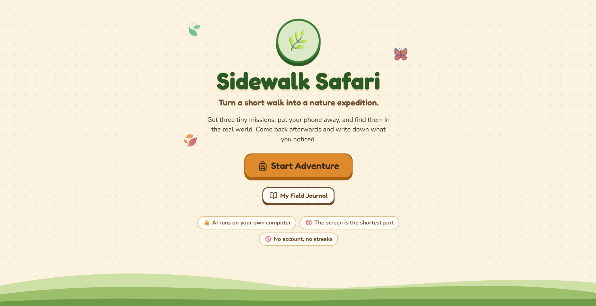
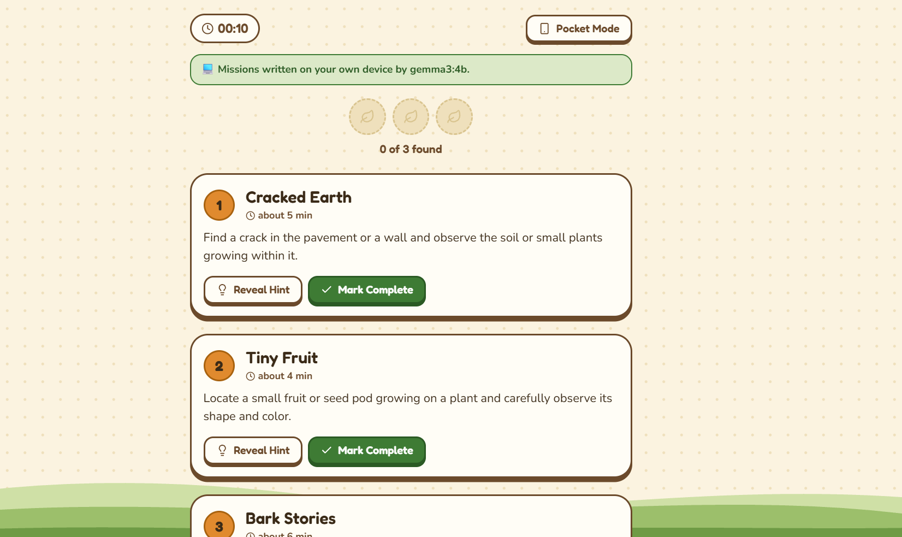
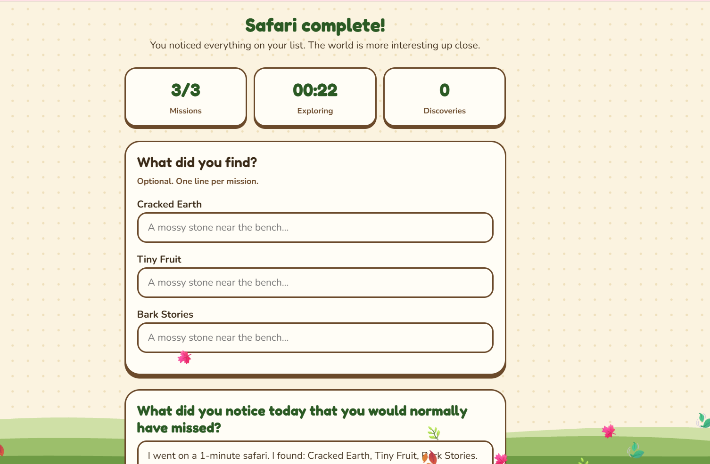

# 🌿 Sidewalk Safari

**Turn an ordinary 5–15 minute walk into a small nature expedition. The AI runs on your own computer.**

Sidewalk Safari uses a local open-weight language model (Gemma 3 4B via Ollama) to write three short observation missions for your walk. You put your phone away, find them in the real world, then come back and record what you noticed in a field journal saved in your browser.

Built for the [Hacktoberfest Open-Source AI Challenge, Week 1: Touch Grass](https://dev.to/challenges/hacktoberfest-week1-2026-10-05).


[](https://hacktoberfest.com)
[](https://dev.to)
[](LICENSE)






## Features

- **Start an adventure:** choose 5, 10, or 15 minutes; campus, park/garden, neighborhood, or anywhere; easy, curious, or explorer difficulty.
- **AI mission generator:** three short, safe missions (title, task, hint, estimated time, "what you might learn"), validated before they reach the screen.
- **Mission cards:** reveal-hint, mark-complete, a progress meter, a timer, and a field note after each find.
- **Pocket Mode:** a dark, minimal screen with only the timer, so you can put the phone away.
- **Field journal:** one line per discovery plus a reflection, saved locally. Browse past safaris any time.
- **No accounts, no streaks, no notifications, no leaderboards.**

## Why open AI

- **Private:** the browser, API and model all run on localhost. The server only receives walk length, surroundings, and difficulty. Your journal stays in your browser's localStorage.
- **Offline:** once the model is downloaded, missions are generated without an internet connection. Fonts and styles are bundled.
- **Model freedom:** the model is an environment variable. Change it, edit the prompt, or change the validation rules without rewriting the app.

## Architecture

```
┌────────────────────┐   POST /api/missions    ┌───────────────────┐    /api/chat    ┌────────────┐
│ React + Vite (UI)  │ ──────────────────────► │ FastAPI (backend) │ ──────────────► │   Ollama   │
│ Bootstrap 5        │ ◄────────────────────── │ validate + retry  │ ◄────────────── │ gemma3:4b  │
│ localStorage       │   missions + source     │ fallback pack     │                 └────────────┘
└────────────────────┘                         └───────────────────┘
        localhost:5173 (dev proxy → :8000)            localhost:8000                    localhost:11434
```

## Quick start

### Prerequisites

- [Ollama](https://ollama.com/download)
- Python 3.10 or newer
- A current Node.js LTS

### 1. Get the model

```bash
ollama pull gemma3:4b
```

(about 3.3 GB; needs a few GB of free RAM when running)

### 2. Start the backend

Windows (PowerShell):

```powershell
cd backend
python -m venv .venv
.venv\Scripts\Activate.ps1
pip install -r requirements.txt
uvicorn main:app --port 8000
```

macOS / Linux:

```bash
cd backend
python3 -m venv .venv
source .venv/bin/activate
pip install -r requirements.txt
uvicorn main:app --port 8000
```

Check it: <http://localhost:8000/api/health> should show `"ollama_reachable": true` and `"text_model_installed": true`.

### 3. Start the frontend

```bash
cd frontend
npm install
npm run dev
```

Open <http://localhost:5173>. The first safari takes a little while because the model has to be loaded and run on your hardware.

### Optional: run as a single process

```bash
cd frontend
npm run build
cd ../backend
uvicorn main:app --port 8000
```

Then open <http://localhost:8000>. The backend serves the built frontend from `frontend/dist`.

## Configuration

Set these as environment variables before starting the backend.

| Variable | Default | Purpose |
|---|---|---|
| `TEXT_MODEL` | `gemma3:4b` | Ollama model used to write missions |
| `OLLAMA_URL` | `http://localhost:11434` | Where Ollama is running |
| `LLM_TIMEOUT` | `120` | Seconds to wait for each model call |
| `LLM_TEMPERATURE` | `0.3` | Sampling temperature |
| `LLM_FORMAT_MODE` | `prompt` | `prompt` asks for JSON in the prompt; `schema` uses Ollama's JSON-schema constrained output |

Example (PowerShell):

```powershell
$env:TEXT_MODEL = "your-model-name"
uvicorn main:app --port 8000
```

Any Ollama model that can follow a JSON instruction should work. Every response is validated, so bad output falls back safely.

## API

### `GET /api/health`

```json
{
  "ollama_reachable": true,
  "text_model": "gemma3:4b",
  "text_model_installed": true,
  "vision_model": "gemma3:4b",
  "vision_model_installed": true,
  "format_mode": "prompt"
}
```

### `POST /api/missions`

Request:

```json
{ "duration": 10, "surroundings": "campus", "difficulty": "easy" }
```

- `duration`: `5`, `10`, or `15`
- `surroundings`: `campus`, `park`, `neighborhood`, or `anywhere`
- `difficulty`: `easy`, `curious`, or `explorer`

Response:

```json
{
  "missions": [
    {
      "title": "Three Shades of Green",
      "task": "Find one leaf showing three different shades of green.",
      "hint": "Check the underside and near the veins.",
      "minutes": 3,
      "learn": "Leaf color changes with age and sunlight."
    }
  ],
  "source": "ai",
  "model": "gemma3:4b",
  "notice": null,
  "elapsed_seconds": 44.1
}
```

`source` is `"ai"` for model-written missions, or `"fallback"` when the built-in pack was served (with an explanation in `notice`).

## How mission generation works

1. Three focus themes are sampled in code from grouped lists (leaf shape, bark, insect traces, light and shadow, small things, soil and stones, and so on), so two missions never cover the same thing.
2. A short prompt asks the model for exactly three missions as JSON.
3. The reply is parsed and validated with Pydantic: exactly three missions, length limits on every field.
4. A safety filter rejects any mission that tells you to touch, feel, smell, taste, pick something, or close your eyes.
5. If validation fails, one retry runs with feedback about why.
6. Estimated minutes are scaled so they never add up to more than the chosen walk.
7. If the model is unavailable or fails twice, a curated fallback pack is served and clearly labeled as not AI-generated.

## Project structure

```
sidewalk-safari/
├── backend/
│   ├── main.py            # FastAPI app and routes
│   ├── llm.py             # Ollama client (model-agnostic)
│   ├── schemas.py         # Pydantic models and safety validation
│   ├── prompts.py         # Prompt templates and theme groups
│   ├── fallback.json      # Built-in offline mission pack
│   └── requirements.txt
├── frontend/
│   └── src/
│       ├── App.jsx        # Screen state machine
│       ├── screens/       # Landing, Setup, Loading, Active, Complete, History, Error
│       ├── components/    # Hills, Choice, MissionCard
│       └── lib/           # api.js, storage.js, useStopwatch.js
├── docs/screenshots/
├── LICENSES.md
└── README.md
```

## Privacy

- The only data sent to the backend is walk length, surroundings, and difficulty.
- Journal entries and safari history are stored in your browser's localStorage under `sidewalk-safari:v1:entries`. There is no database and no account.
- No analytics, no tracking, no third-party AI service. To remove everything, clear this site's data in your browser.

## Performance

Measured on an AMD Ryzen laptop with about 16 GB RAM and no GPU, using `gemma3:4b`: roughly 10 tokens per second, around 45 seconds per set of three missions. A GPU or a smaller model will be faster, and the loading screen is designed to make the wait part of the walk.

## Roadmap

- Optional photo notes using a local vision-capable model
- Export and import for the field journal
- More themes and seasonal missions

## Licenses

| Component | License |
|---|---|
| Sidewalk Safari (this repo) | MIT, see `LICENSE` |
| Gemma 3 (model weights) | Gemma Terms of Use and Prohibited Use Policy (open weights, not OSI open source) |
| Ollama | MIT |
| FastAPI, Pydantic | MIT |
| Uvicorn, httpx | BSD-3-Clause |
| React, Vite, Bootstrap | MIT |
| lucide-react | ISC |
| Fredoka, Nunito (via Fontsource) | SIL Open Font License 1.1 |

See [`LICENSES.md`](LICENSES.md) for details.

## Acknowledgements

Built for the Hacktoberfest Open-Source AI Challenge, Week 1: Touch Grass. Go outside.
